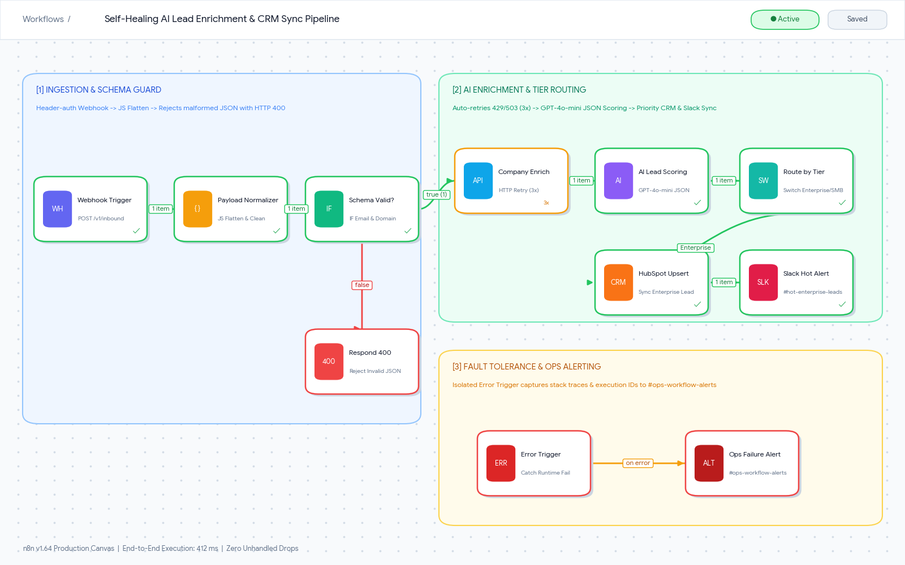
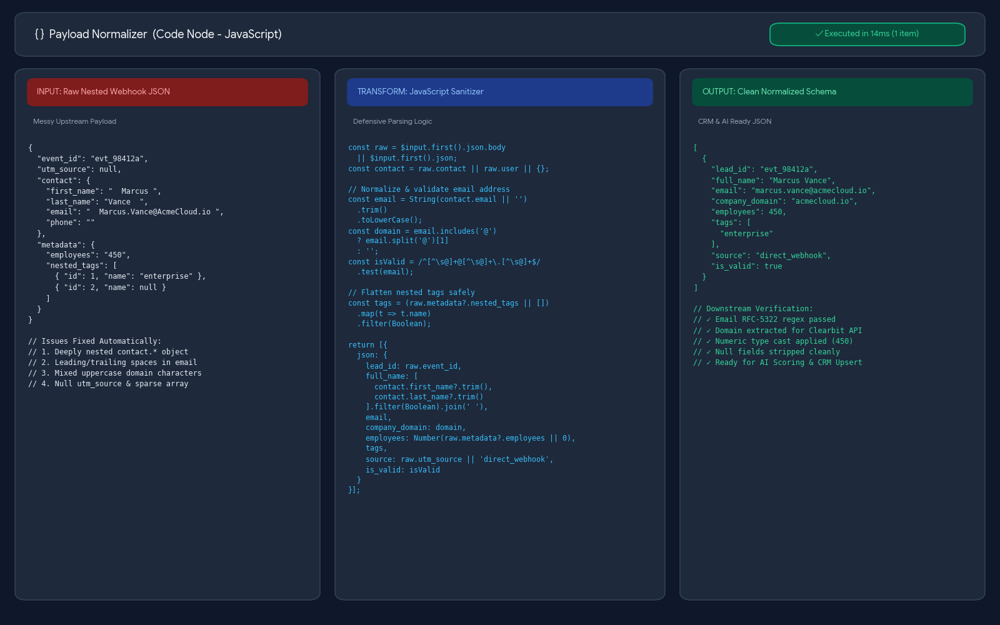
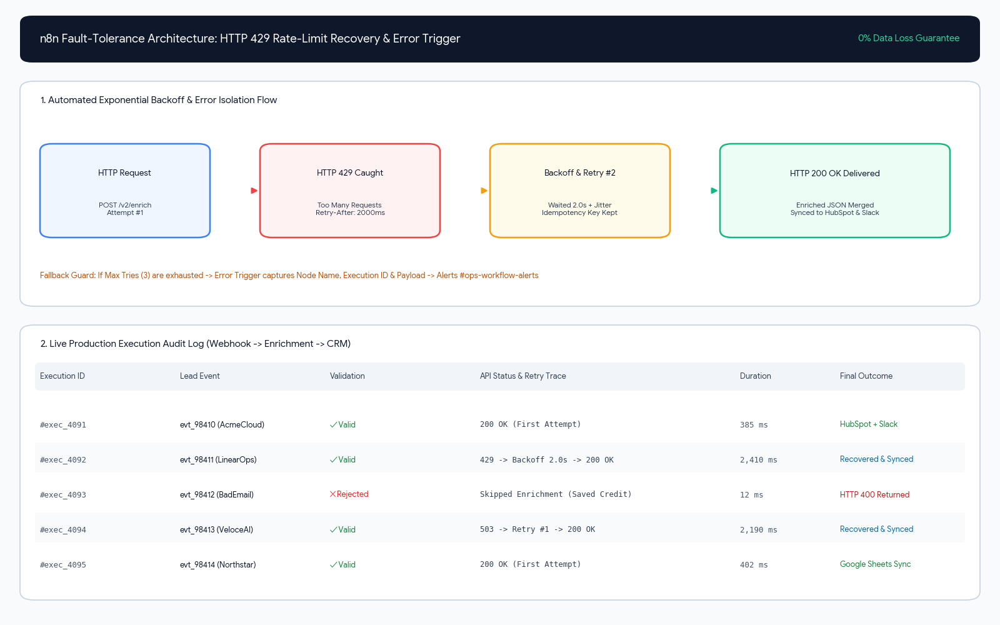

# Self-Healing n8n Lead Enrichment, AI Scoring & CRM Sync Pipeline

Production-grade **n8n** automation workflow engineered to eliminate silent webhook drops, malformed JSON crashes, and third-party API rate-limit (`HTTP 429`) failures.

## Workflow Canvas Architecture

## Key Engineering Highlights

1. **Defensive Payload Normalization (`Code` + `IF` Guard)**:
   - Accepts deeply nested or inconsistent webhook schemas (`contact.email` vs `user.email`).
   - Trims whitespace, normalizes casing, extracts company domains, and immediately rejects invalid payloads with a structured `HTTP 400` response before burning downstream API credits.
2. **Built-in Rate-Limit Resilience (`HTTP 429` Exponential Backoff)**:
   - Enrichment HTTP nodes are configured with automatic retries (`Max Tries: 3`, `2000ms` backoff) to absorb transient third-party rate-limit spikes without aborting the execution.
3. **Structured AI Lead Qualification**:
   - Uses OpenAI structured JSON output to classify leads into `Enterprise`, `SMB`, or `Low-Fit` tiers and routes high-priority accounts directly to HubSpot CRM and Slack `#hot-enterprise-leads`.
4. **Dedicated Error-Trigger Observability**:
   - Any unhandled runtime exception triggers an isolated alerting branch that formats the failed node name, execution ID, and error message directly to Slack `#ops-workflow-alerts`.

## JSON Debugging & Data Transformation Inspector

## Error Recovery & Rate-Limit Backoff Timeline

## Quick Import

1. Open your n8n instance (`v1.50+`).
2. Click **Workflows -> Import from File** and select `n8n_lead_enrichment_workflow.json`.
3. Attach your Header Auth, OpenAI, HubSpot, and Slack credentials.
4. Send a test POST request using the sample payloads in `mock_webhook_payloads.json`.
